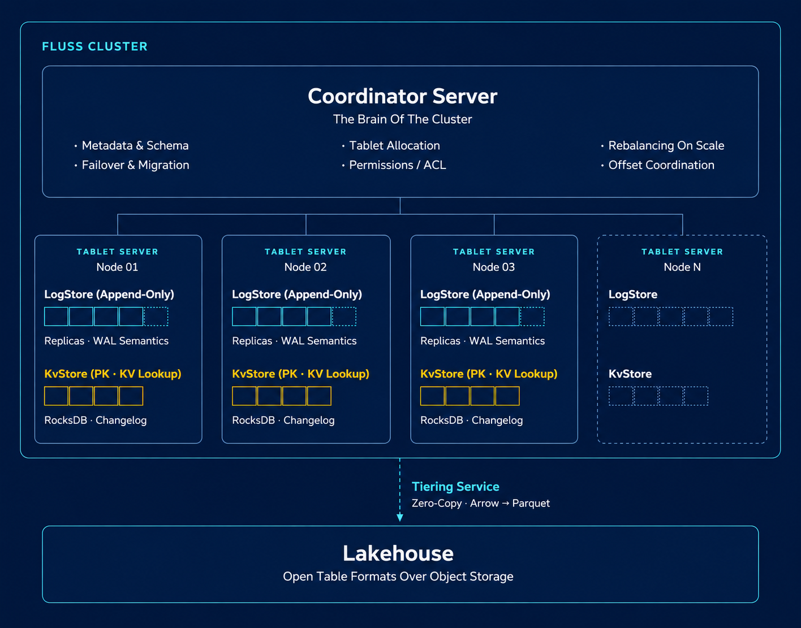
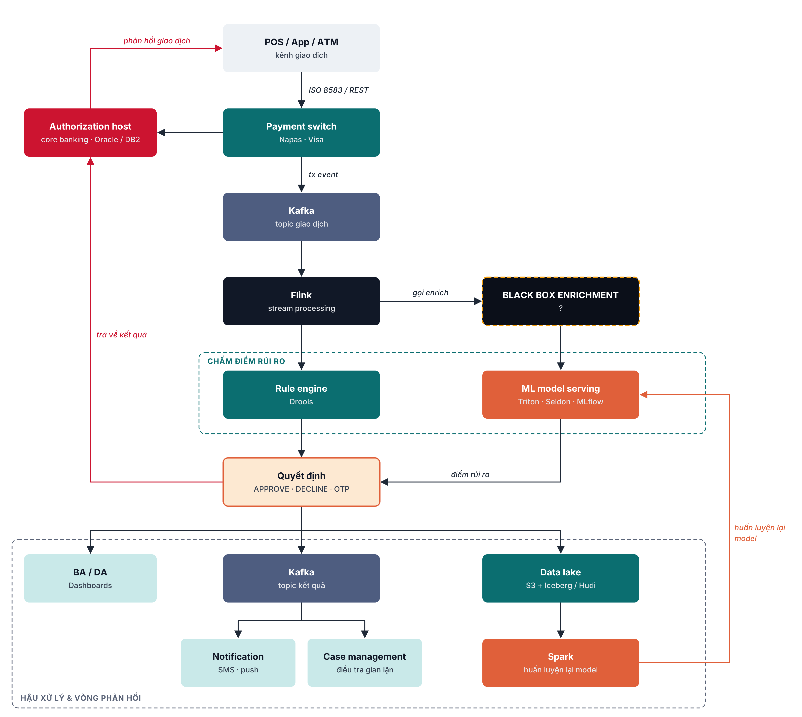
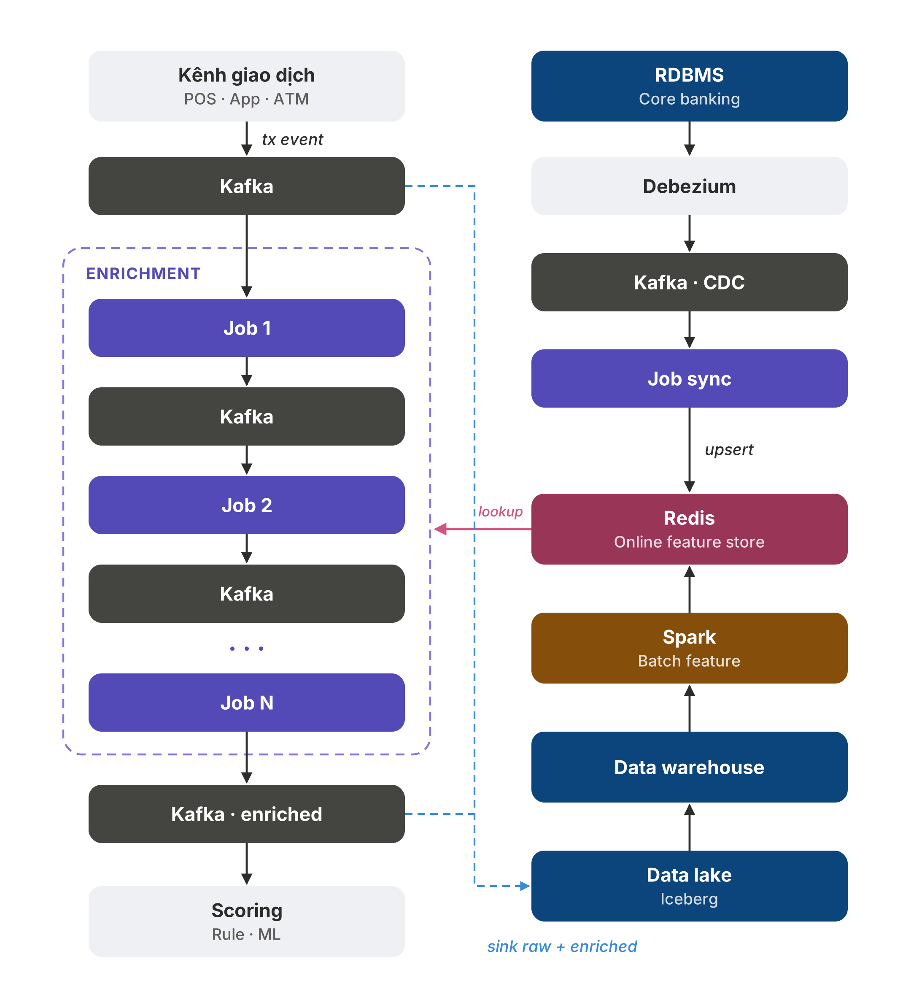
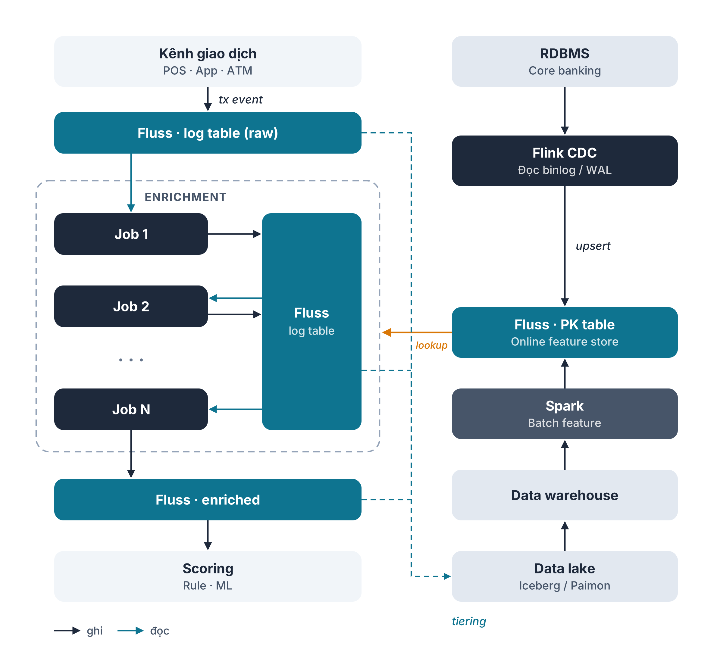

<div align="center">

# Realtime Feature Lookup

**So sánh hai kiến trúc enrich giao dịch theo thời gian thực cho hệ thống phát hiện gian lận ngân hàng**

Flink + Kafka + Redis &nbsp;·&nbsp; vs &nbsp;·&nbsp; Flink + Apache Fluss

</div>

---

## Mục lục

1. [Apache Fluss là gì](#apache-fluss-là-gì)
2. [Bài toán: Fraud Detection trong ngân hàng](#bài-toán-fraud-detection-trong-ngân-hàng)
3. [Black box enrichment: hai hướng](#black-box-enrichment-hai-hướng)
4. [Chạy benchmark](#chạy-benchmark)

---

## Apache Fluss là gì

Apache Fluss là **streaming storage** được thiết kế riêng cho Flink. Một cụm Fluss thay được nhiều hệ thống riêng lẻ:

| Thành phần | Vai trò | Tương đương |
|---|---|---|
| **Log table** | Append-only, đọc/ghi luồng sự kiện | Kafka topic |
| **Primary-key table** | KV store trên RocksDB, upsert và lookup theo key, tự sinh changelog | Redis / feature store |
| **Tiering** | Đẩy dữ liệu xuống lakehouse (Paimon / Iceberg) | Job đồng bộ riêng |

Cụm gồm **Coordinator Server** (metadata, phân bổ tablet, failover) và các **Tablet Server** (chứa LogStore và KvStore).

<p align="center">
  
</p>

Tìm hiểu thêm: [Tài liệu chính thức Apache Fluss](https://fluss.apache.org/docs/0.6/)

---

## Bài toán: Fraud Detection trong ngân hàng

Khi khách quẹt thẻ hoặc chuyển khoản, sự kiện giao dịch đi vào Kafka, Flink xử lý luồng rồi chấm điểm rủi ro bằng
rule engine và ML model để ra quyết định **APPROVE / DECLINE / OTP**, thường chỉ trong vài trăm mili giây.

Bản thân giao dịch có rất ít thông tin. Trước khi chấm điểm phải **enrich**: gắn thêm hồ sơ khách hàng như hạng KYC,
thu nhập, hạn mức thẻ, điểm rủi ro, nhóm nợ CIC. Dự án tập trung vào khối **black box enrichment**, với hai yêu cầu:

- **Nhanh**: kịp ngân sách thời gian của luồng phê duyệt.
- **Tươi**: thấy ngay thay đổi vừa xảy ra ở core banking (ví dụ thẻ vừa bị khoá).

<p align="center">
  
</p>

---

## Black box enrichment: hai hướng

### Stack A: hướng truyền thống (Flink + Kafka + Redis)

- Hồ sơ khách từ Oracle được **Debezium** đọc qua CDC, đẩy vào Kafka, một job Flink đồng bộ sang **Redis**.
- Giao dịch đi qua Kafka. Job Flink enrich bằng **Async I/O** tra Redis rồi ghi kết quả ra Kafka.

<p align="center">
  
</p>

### Stack B: hướng mới (Flink + Fluss)

- **Flink CDC** đọc Oracle và upsert thẳng vào **Fluss PK table**.
- Giao dịch và kết quả nằm trên **Fluss log table**. Enrich là một câu **lookup join** Flink SQL.

<p align="center">
  
</p>

### So sánh nhanh

| | Stack A | Stack B |
|---|---|---|
| CDC | Debezium trên Kafka Connect | Flink CDC |
| Feature store | Redis Cluster (3 master) | Fluss PK table (3 tablet-server) |
| Luồng giao dịch | Kafka (3 broker), key `user_id` | Fluss log table, `bucket.key = user_id` |
| Logic enrich | Java, Async I/O tự viết | Flink SQL lookup join |
| Số job Flink | 2 | 2 (đều là SQL) |
| RAM tối đa (cả tools) | 9.41 GiB | 9.15 GiB |

Hot key: 80% giao dịch dồn vào 20 user cố định (giống nhau ở cả hai stack), bật ở thời điểm ngẫu nhiên trong lúc đo.

---

## Chạy benchmark

**Yêu cầu:** Docker, Java 17, Maven. Chạy ở thư mục gốc repo và **mỗi lần chỉ bật một stack**.
Kết quả nằm trong `bench/results/`.

### Stack A

```bash
# A1. Build lại toàn bộ jar
make build

# A2. Bật Stack A (Oracle, Kafka 3 broker, Kafka Connect, Redis 3 node, Flink), không build image
docker compose --project-directory infra -f infra/compose.common.yml -f infra/compose.kafka.yml -f infra/compose.stack-a.yml up -d --wait

# A3. Deploy: ghép Redis Cluster, đăng ký Debezium, Job A1 nạp 100k profile vào Redis qua CDC, submit Job A2
make deploy-a

# A4. Kiểm tra tính đúng (phải ra "ALL PASSED")
make test STACK=a

# A5. Benchmark 5 mức tải (1k → 50k tx/s), có hot key
make bench STACK=a LABEL=hot HOT=1 REPS=3 DURATION=60

# A6. Đo freshness. Phải chạy TRƯỚC khi tắt Stack A
make probe STACK=a
```

### Stack B

```bash
# B1. Tắt Stack A (giữ dữ liệu Oracle)
make down

# B2. Bật Stack B (Oracle, ZooKeeper, Fluss 3 tablet-server, Flink), không build image
docker compose --project-directory infra -f infra/compose.common.yml -f infra/compose.stack-b.yml up -d --wait

# B3. Đợi Fluss sẵn sàng rồi deploy: tạo bảng Fluss, CDC snapshot 100k profile, submit job enrichment
sleep 30 && make deploy-b

# B4. Kiểm tra tính đúng
make test STACK=b

# B5. Benchmark với ĐÚNG tham số như Stack A
make bench STACK=b LABEL=hot HOT=1 REPS=3 DURATION=60

# B6. Đo freshness
make probe STACK=b
```

### Tổng hợp kết quả

```bash
make report    # tạo bench/results/report.md và biểu đồ
```

| Địa chỉ | Dùng để |
|---|---|
| <http://localhost:8081> | Flink UI |
| <http://localhost:3000> | Grafana: metric Flink của cả hai stack |
